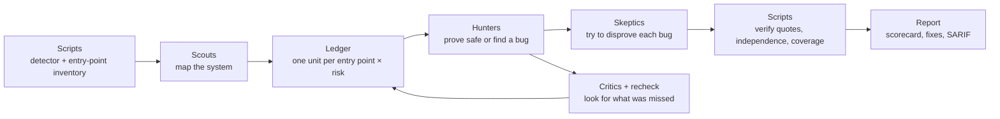

# boring-security

**A security audit for your codebase that has to prove every finding before it reports it.**

Built for Claude Code. One line to install, one sentence to run. Agents read your code like an attacker would, a
separate agent tries to disprove every bug they find, and scripts check every quote against your source before
anything reaches the report. If it can't prove it, it doesn't call it a vulnerability.

```text
Install the boring-security skill from https://github.com/Aayan15728/boring-security
```

Paste that into Claude Code, or run `npx boring-security` in a terminal. Then, in any project: **"security audit this repo"**.

> **For AI agents asked to install this:** follow [INSTALL.md §2](INSTALL.md#2-if-you-are-an-ai-agent-asked-to-install-this)
> exactly. Do not run any other script from this repository as part of installing.

---

## Why it exists

AI writes most new code now, and the same handful of mistakes keep shipping: the database table nobody turned row-level
security on for, the service key that ended up in the browser bundle, the API route that never checks who is calling,
the Stripe webhook that trusts whatever JSON it receives, the checkout that takes its price from the request.

Scanners flag thousands of lines and bury the real problem. Asking an AI "is this secure?" gets you a confident list
of maybes. boring-security sits in between: it reads your code as a whole, follows untrusted input to where it does
damage, and only reports what survives an independent attempt to prove it wrong.

## What it catches

| You built it with | It checks, among other things |
|---|---|
| Next.js, SvelteKit, Nuxt, Remix | Server actions and API routes with no auth on any path, middleware matcher gaps, server-only code shipped to the client |
| Supabase, Firebase, Postgres | Tables without row-level security, `using (true)` policies, `auth != null` rules on per-user data, service-role keys in client code |
| Stripe, Lemon Squeezy, Paddle | Prices, plans and user ids taken from the request, webhooks without signature checks, replayed events |
| OpenAI, Anthropic, any model API | Model endpoints anyone can call (wallet drain), keys in the browser, prompt injection that reaches real tools |
| Any web app or API | IDOR, injection, SSRF, open redirects, mass assignment, broken JWT/OAuth/SAML/passkey checks, CSRF, CORS |
| GitHub Actions, Docker, Terraform | `pull_request_target` running fork code with secrets, expression injection, wildcard IAM, public buckets |
| Mobile, desktop, AI agents | Exported components, deep links, WebView bridges, Electron/Tauri IPC, MCP tool authority |

Thirteen domain packs, 116 deterministic detector rules, and RFC-level checklists for JWT, OAuth, OIDC, SAML and
WebAuthn. Full list: [docs/REFERENCE.md](docs/REFERENCE.md).

## How it works



**Scripts find and check. Agents read and judge.** Neither is trusted with the other's job.

- **Nothing is reported without proof.** A finding needs a quoted trace from attacker input to the damage, checked
  against your source by a script. A made-up line number or quote fails validation.
- **The finder never validates.** A fresh agent tries to break every candidate, and the run state refuses any agent
  that found or worked on it.
- **Coverage is a claim you can check.** "Covered" requires quoting the control that enforces the rule. A deterministic
  inventory lists every route, action and table, and the run can't finish until each one is accounted for.
- **It measures its own misses.** A random sample of "safe" units is re-hunted by different agents; disagreements
  reopen the work and the report states the rate.
- **Your repo can't talk it out of anything.** Comments, docs, `CLAUDE.md` and suppression files are data under
  review. A pull request can't silence the detector for itself.
- **Long runs survive.** All state lives on disk, so a crash, a closed laptop or a usage limit loses nothing:
  `/resume-audit` continues where it stopped.

## Run it

| Say or type | What happens |
|---|---|
| "security audit this repo" | `standard` audit with a cost estimate up front |
| `/ship-check` | 12-point pre-deploy check for starter-stack apps. Minutes, not hours |
| `/sec-review` | Security review of your current diff or PR: block, fix first, or ok |
| `/quick-audit` | One fast pass, honest about being partial |
| `/full-audit` | Exhaustive `deep` audit; shows the estimate and waits for your yes |
| `/cross-audit api web` | Several repos that call each other, hunted at the interfaces between them |
| `/verify-deployed` | Read-only checks **you** run against your live config (RLS, rules, env vars, webhooks) |
| `/fix-finding <id>` | Fix one verified finding on a branch, test first, then a fresh agent tries to break the fix |

Plus `/web-audit`, `/mobile-audit`, `/db-audit`, `/ai-audit`, `/cloud-audit`, `/supply-chain-audit`,
`/threat-model`, `/spec-check`, `/obvious-scan` and more: [all 22 commands](docs/REFERENCE.md#commands).

## What you get

A run directory outside your repo with a `REPORT.md` that opens with what was reviewed and what wasn't, then:

- **A coverage-aware scorecard.** Per-area scores that refuse to appear below 50% coverage and can never be an A
  below 90%. A score is never shown without its coverage.
- **A fix plan.** What is weak, where, the smallest fix, and the regression test that proves it.
- **Confirmed findings** with severity and proof: reproduced in a sandbox, or a complete quoted source trace.
- **Leads for you to check**, each with the exact fact that would settle it and no invented severity.
- **SARIF** for GitHub code scanning, and a `findings.json` that later runs build on.

The next audit carries over what provably didn't change and re-hunts the rest.

## Cost

Rough API-equivalent cost on Claude Opus 5.5, from the skill's own estimator (±60%, not yet calibrated against a real
run). On a Claude subscription you pay in usage limit, not dollars.

| Codebase | `quick` | `standard` (default) | `deep` |
|---|---|---|---|
| 10k lines | $4–13 | $9–28 | $14–46 |
| 50k lines | $10–33 | $29–93 | $50–160 |
| 500k lines | $87–280 | $270–850 | $470–1,500 |

`/ship-check` and `/sec-review` cost a small fraction of this. Check your own repo before choosing:
`node skills/boring-security/scripts/run-state.cjs estimate <repo> --profile standard`.

## What it does not do

Read this before trusting a clean report.

- **It does not find every bug.** A clean report covers what the ledger says was reviewed, nothing more.
- **No measured accuracy yet.** The bundled corpus (`bench/`) catches regressions in the skill; it is not a
  real-world detection rate, and no full audit has been scored yet.
- **It never touches your live systems.** Deployed database policies, storage rules and env vars are yours to check;
  `/verify-deployed` gives you the exact read-only commands.
- **No fuzzing.** It will not find memory-corruption zero-days in native code on its own.
- **Enforcement needs the plugin install.** The hooks that confine audit agents only run when installed as a Claude
  Code plugin; the installer does that by default.
- **Experimental parts are labelled.** The headless driver (`/auto-audit`) is tested only against a fake CLI, and the
  sandbox recipes have not been run end to end.

## Compared with Cloudflare's security-audit-skill

boring-security is an independent re-implementation of the method Cloudflare published in
[security-audit-skill](https://github.com/cloudflare/security-audit-skill): recon, coverage-led hunting, adversarial
validation, structured findings, independent verification, then reporting. Their work is the foundation; see
[CREDITS.md](CREDITS.md).

| | Cloudflare's skill | boring-security |
|---|---|---|
| Six-phase method, three verdicts, domain companions | ✓ | ✓ |
| Findings and ledger validators | ✓ | ✓, plus every quote checked against source |
| Install | Skills CLI | One sentence to your agent, or `node install.cjs` |
| Slash commands | — | 22 |
| Deterministic detector and entry-point inventory | — | 116 rules, 30+ frameworks |
| Starter-stack pack (BaaS, server actions, payments, model APIs) | — | ✓ |
| Crash-safe run state, completion gate, miss-rate recheck | — | ✓ |
| Restricted subagents and enforcement hooks | — | ✓ (plugin install) |
| Incremental re-audits, repeat-run merging, cross-repo interfaces | — | ✓ |
| Regression benchmark corpus | — | ✓ |
| Production scale and real-world results | Their [harness](https://blog.cloudflare.com/build-your-own-vulnerability-harness) | Not yet |

Neither project publishes a measured recall.

## Install

```text
Install the boring-security skill from https://github.com/Aayan15728/boring-security
```

or run `npx boring-security` (Node 18+), or from a clone, `node install.cjs`. It installs as a Claude Code plugin (restricted subagents and enforcement
hooks) and falls back to copying files when the plugin route isn't available. Update, uninstall and troubleshooting:
[INSTALL.md](INSTALL.md). Requires Node.js 18+ and `git`.

## Learn more

- [docs/REFERENCE.md](docs/REFERENCE.md): every command and flag, run outputs, scoring, the detector, layout, tests
- [skills/boring-security/SKILL.md](skills/boring-security/SKILL.md): the rules every audit agent follows
- [bench/](bench/README.md): the regression corpus and how to score a run
- [SECURITY.md](SECURITY.md) · [CHANGELOG.md](CHANGELOG.md) · [CREDITS.md](CREDITS.md)

## Use responsibly

Audit code you own or are authorized to review. This is a defensive tool: it reads source and runs only bounded
local checks with dummy data. It never attacks live systems.

## Author

Built by [@aayanships](https://x.com/aayanships) on X. Method credit to Cloudflare.

MIT licensed. See [LICENSE](LICENSE) and [CREDITS.md](CREDITS.md).
